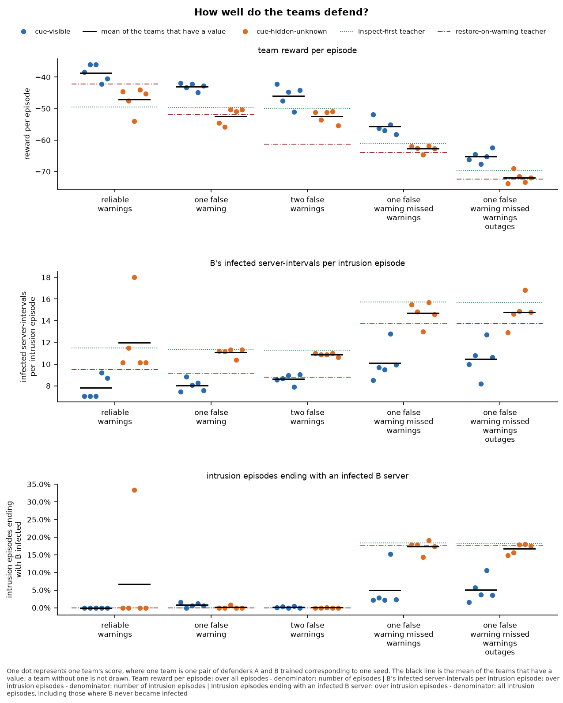
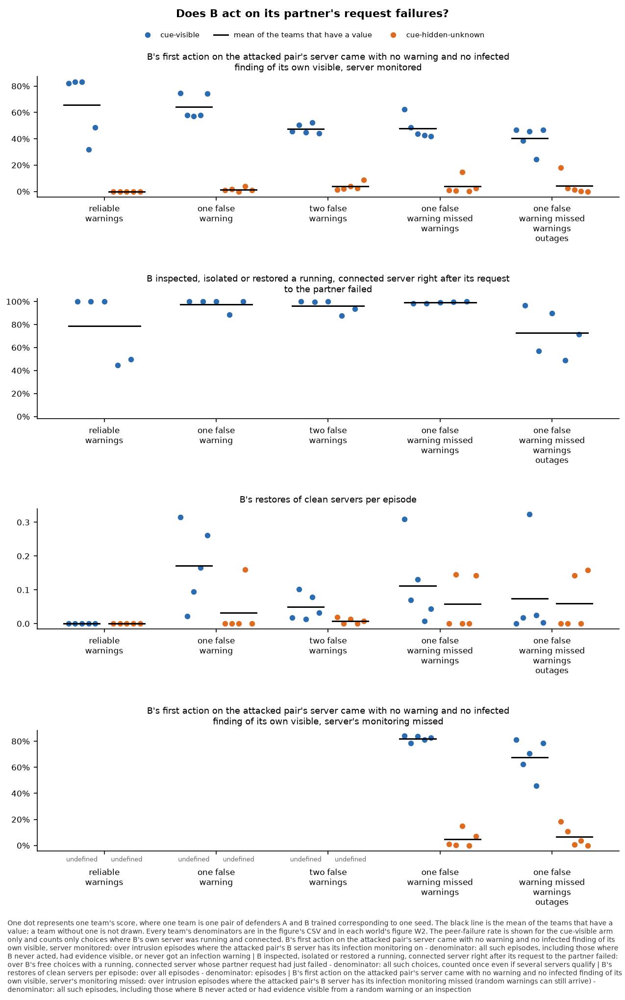
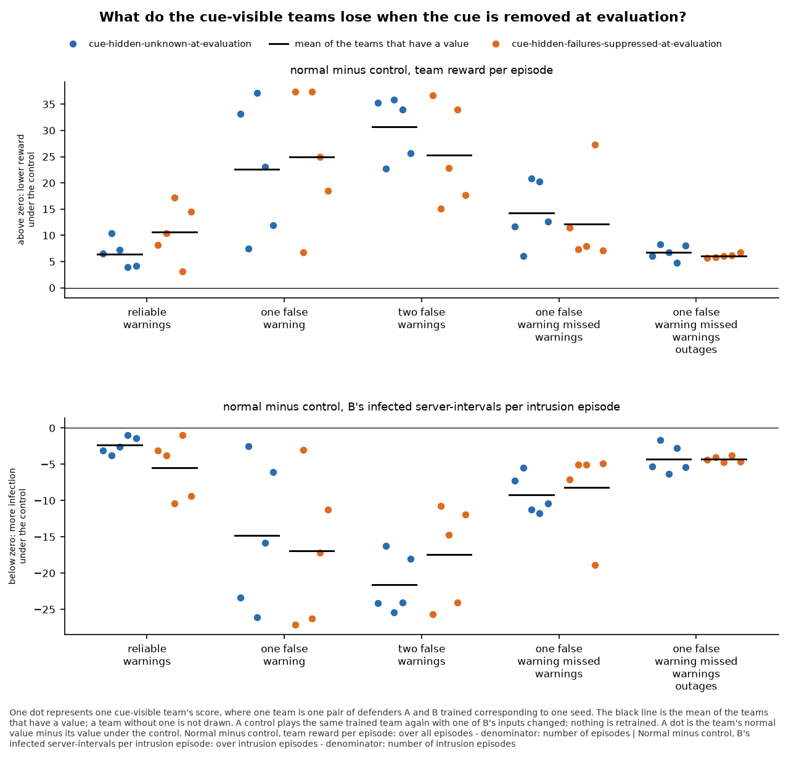

# Study 1, the receiver, does B use A's interruptions?

The study's five worlds side by side. A value is the mean over the arm's teams that have a value, with their number in brackets. Each world's README lists its teams one by one.

## The worlds

| world | arm | team reward per episode | B's infected server-intervals per intrusion episode | intrusion episodes ending with an infected B server | B's first action on the attacked pair's server came with no warning and no infected finding of its own visible, server monitored | B inspected, isolated or restored a running, connected server right after its request to the partner failed |
|---|---|---|---|---|---|---|
| [reliable warnings](worlds/reliable-warnings/README.md) | cue-visible | -38.63 (5 teams) | 7.822 (5 teams) | 0.0% (5 teams) | 65.7% (5 teams) | 78.9% (5 teams) |
| [reliable warnings](worlds/reliable-warnings/README.md) | cue-hidden-unknown | -47.05 (5 teams) | 11.98 (5 teams) | 6.7% (5 teams) | 0.0% (5 teams) | undefined (0 teams) |
| [one false warning](worlds/one-false-warning/README.md) | cue-visible | -42.97 (5 teams) | 8.028 (5 teams) | 0.79% (5 teams) | 64.4% (5 teams) | 97.7% (5 teams) |
| [one false warning](worlds/one-false-warning/README.md) | cue-hidden-unknown | -52.4 (5 teams) | 11.07 (5 teams) | 0.16% (5 teams) | 1.5% (5 teams) | undefined (0 teams) |
| [two false warnings](worlds/two-false-warnings/README.md) | cue-visible | -45.95 (5 teams) | 8.634 (5 teams) | 0.17% (5 teams) | 47.5% (5 teams) | 96.2% (5 teams) |
| [two false warnings](worlds/two-false-warnings/README.md) | cue-hidden-unknown | -52.47 (5 teams) | 10.88 (5 teams) | 0.02% (5 teams) | 3.8% (5 teams) | undefined (0 teams) |
| [one false warning missed warnings](worlds/one-false-warning-missed-warnings/README.md) | cue-visible | -55.67 (5 teams) | 10.09 (5 teams) | 4.9% (5 teams) | 47.9% (5 teams) | 99.1% (5 teams) |
| [one false warning missed warnings](worlds/one-false-warning-missed-warnings/README.md) | cue-hidden-unknown | -62.73 (5 teams) | 14.72 (5 teams) | 17.3% (5 teams) | 3.9% (5 teams) | undefined (0 teams) |
| [one false warning missed warnings outages](worlds/one-false-warning-missed-warnings-outages/README.md) | cue-visible | -65.17 (5 teams) | 10.47 (5 teams) | 5.0% (5 teams) | 40.4% (5 teams) | 72.7% (5 teams) |
| [one false warning missed warnings outages](worlds/one-false-warning-missed-warnings-outages/README.md) | cue-hidden-unknown | -71.92 (5 teams) | 14.81 (5 teams) | 16.8% (5 teams) | 4.4% (5 teams) | undefined (0 teams) |

Every mean of the study with its standard deviation and number of teams, the baselines and the control differences are in [master_table.csv](master_table.csv). [measurements.csv](measurements.csv) gives every measurement's id, name, population and denominator.

## Figures

### How well do the teams defend?

The points drawn are in [figures/S1-performance.csv](figures/S1-performance.csv), the vector version in [figures/S1-performance.svg](figures/S1-performance.svg).

### Does B act on its partner's request failures?

The points drawn are in [figures/S2-behaviour.csv](figures/S2-behaviour.csv), the vector version in [figures/S2-behaviour.svg](figures/S2-behaviour.svg).

### What do the cue-visible teams lose when the cue is removed at evaluation?

The points drawn are in [figures/S3-controls.csv](figures/S3-controls.csv), the vector version in [figures/S3-controls.svg](figures/S3-controls.svg).

## Worlds

- [reliable warnings](worlds/reliable-warnings/README.md)
- [one false warning](worlds/one-false-warning/README.md)
- [two false warnings](worlds/two-false-warnings/README.md)
- [one false warning missed warnings](worlds/one-false-warning-missed-warnings/README.md)
- [one false warning missed warnings outages](worlds/one-false-warning-missed-warnings-outages/README.md)
