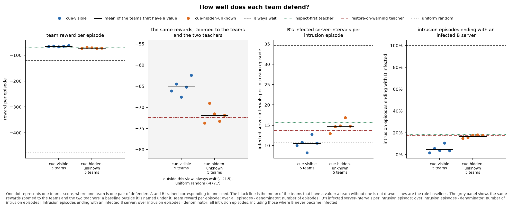
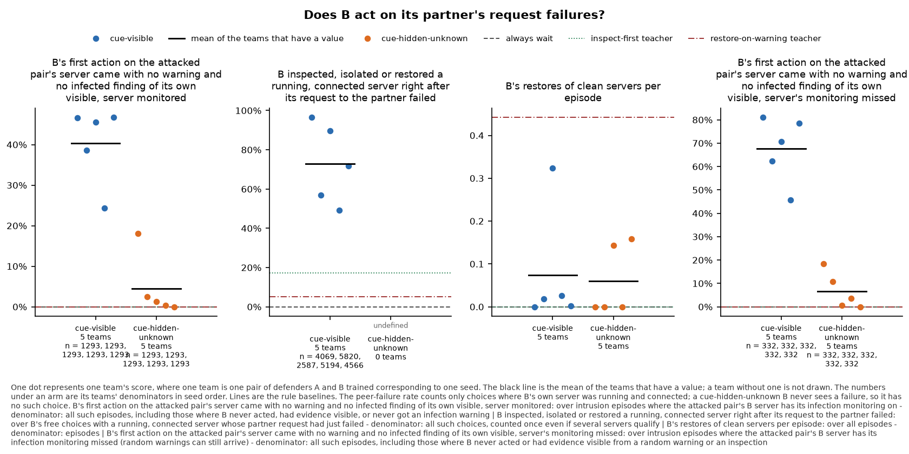
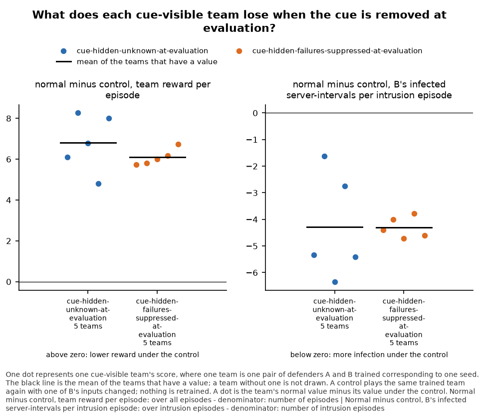
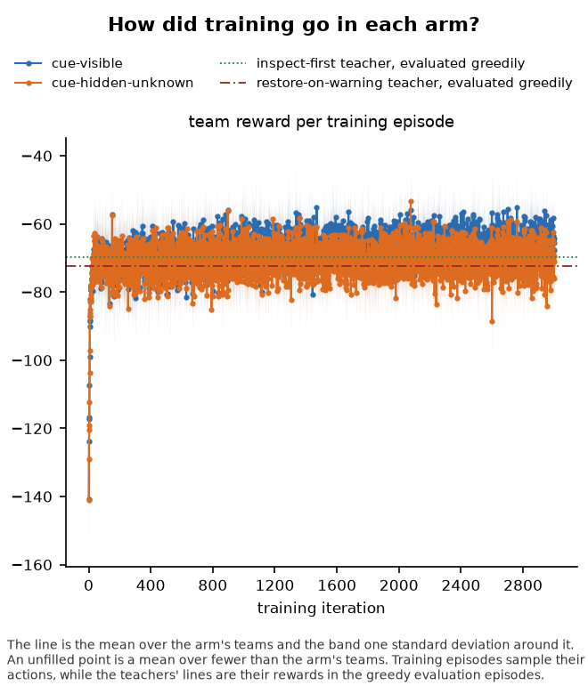

# one false warning missed warnings outages

One world of Study 1, the receiver, does B use A's interruptions?. Every team, baseline and control is scored on the same 2000 episodes; the trained teams and the controls choose greedily and the rule baselines follow their rules. One team is one pair of defenders A and B trained for one seed. A mean is over the teams that have a value, with their number; a value with nothing to count is shown as undefined, never as zero.

## Teams and baselines

|  | team reward per episode | B's infected server-intervals per intrusion episode | intrusion episodes ending with an infected B server | B's first action on the attacked pair's server came with no warning and no infected finding of its own visible, server monitored | B inspected, isolated or restored a running, connected server right after its request to the partner failed |
|---|---|---|---|---|---|
| cue-visible, seed 0 | -66.14 | 9.998 | 1.6% | 46.6% | 96.5% |
| cue-visible, seed 1 | -64.48 | 10.81 | 5.7% | 38.7% | 56.8% |
| cue-visible, seed 2 | -67.6 | 8.194 | 3.7% | 45.6% | 89.6% |
| cue-visible, seed 3 | -65.2 | 12.73 | 10.6% | 24.3% | 49.1% |
| cue-visible, seed 4 | -62.41 | 10.64 | 3.6% | 46.7% | 71.7% |
| **cue-visible, mean** | **-65.17** (5 teams) | **10.47** (5 teams) | **5.0%** (5 teams) | **40.4%** (5 teams) | **72.7%** (5 teams) |
| cue-hidden-unknown, seed 0 | -73.74 | 12.94 | 14.8% | 18.1% | undefined |
| cue-hidden-unknown, seed 1 | -69.07 | 14.63 | 15.6% | 2.5% | undefined |
| cue-hidden-unknown, seed 2 | -71.56 | 14.86 | 17.8% | 1.2% | undefined |
| cue-hidden-unknown, seed 3 | -73.32 | 16.85 | 18.0% | 0.39% | undefined |
| cue-hidden-unknown, seed 4 | -71.93 | 14.77 | 17.5% | 0.0% | undefined |
| **cue-hidden-unknown, mean** | **-71.92** (5 teams) | **14.81** (5 teams) | **16.8%** (5 teams) | **4.4%** (5 teams) | **undefined** (0 teams) |
| always wait | -121.5 | 34.63 | 100.0% | 0.0% | 0.0% |
| inspect-first teacher | -69.74 | 15.7 | 18.3% | 0.0% | 17.2% |
| restore-on-warning teacher | -72.42 | 13.73 | 17.7% | 0.0% | 5.2% |
| uniform random | -477.7 | 10.65 | 14.3% | 66.0% | 28.8% |

Every measurement of every team, baseline and control, with its numerator and denominator, is in [world_table.csv](world_table.csv). Each arm's five teams with their mean, standard deviation, minimum and maximum are in `training-arms/<arm>/arm_summary.csv`. The study's measurements.csv defines every measurement.

## Figures

### How well does each team defend?

The points drawn are in [figures/W1-performance.csv](figures/W1-performance.csv), the vector version in [figures/W1-performance.svg](figures/W1-performance.svg).

### Does B act on its partner's request failures?

The points drawn are in [figures/W2-behaviour.csv](figures/W2-behaviour.csv), the vector version in [figures/W2-behaviour.svg](figures/W2-behaviour.svg).

### What does each cue-visible team lose when the cue is removed at evaluation?

The points drawn are in [figures/W3-controls.csv](figures/W3-controls.csv), the vector version in [figures/W3-controls.svg](figures/W3-controls.svg).

### How did training go in each arm?

The points drawn are in [figures/W4-learning.csv](figures/W4-learning.csv), the vector version in [figures/W4-learning.svg](figures/W4-learning.svg).

## Example episodes

No episode has been chosen yet.
