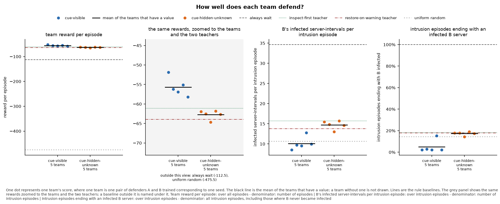
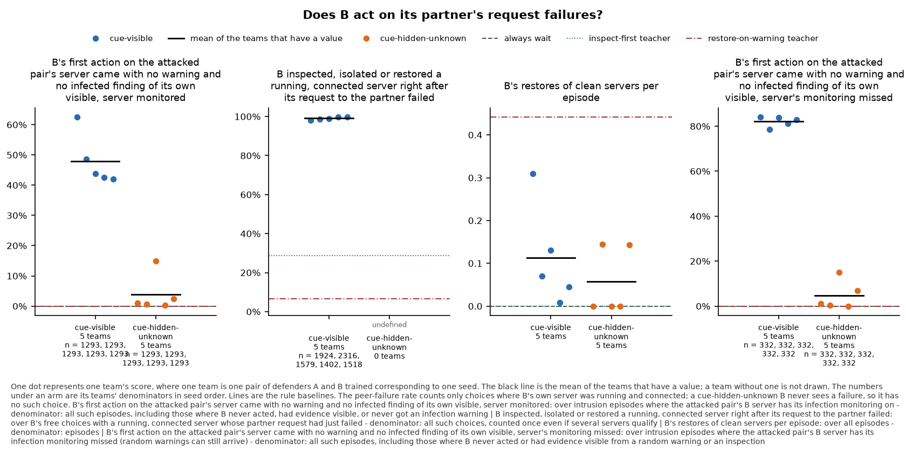
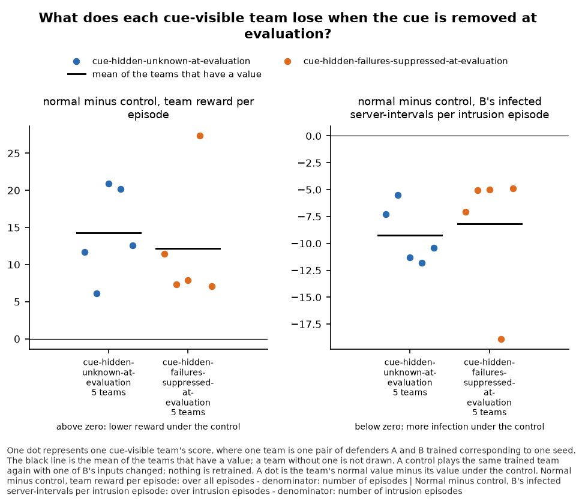
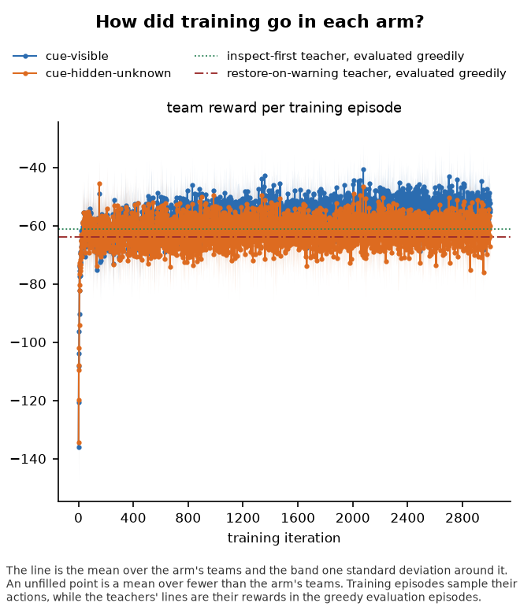

# one false warning missed warnings

One world of Study 1, the receiver, does B use A's interruptions?. Every team, baseline and control is scored on the same 2000 episodes; the trained teams and the controls choose greedily and the rule baselines follow their rules. One team is one pair of defenders A and B trained for one seed. A mean is over the teams that have a value, with their number; a value with nothing to count is shown as undefined, never as zero.

## Teams and baselines

|  | team reward per episode | B's infected server-intervals per intrusion episode | intrusion episodes ending with an infected B server | B's first action on the attacked pair's server came with no warning and no infected finding of its own visible, server monitored | B inspected, isolated or restored a running, connected server right after its request to the partner failed |
|---|---|---|---|---|---|
| cue-visible, seed 0 | -51.89 | 8.513 | 2.2% | 62.5% | 98.2% |
| cue-visible, seed 1 | -56.22 | 9.686 | 2.8% | 48.6% | 98.6% |
| cue-visible, seed 2 | -56.92 | 9.511 | 2.2% | 43.9% | 99.1% |
| cue-visible, seed 3 | -55.07 | 12.78 | 15.2% | 42.6% | 99.7% |
| cue-visible, seed 4 | -58.23 | 9.946 | 2.3% | 42.1% | 99.9% |
| **cue-visible, mean** | **-55.67** (5 teams) | **10.09** (5 teams) | **4.9%** (5 teams) | **47.9%** (5 teams) | **99.1%** (5 teams) |
| cue-hidden-unknown, seed 0 | -61.97 | 15.47 | 17.8% | 1.1% | undefined |
| cue-hidden-unknown, seed 1 | -62.55 | 14.82 | 17.9% | 0.70% | undefined |
| cue-hidden-unknown, seed 2 | -64.66 | 13.01 | 14.3% | 14.9% | undefined |
| cue-hidden-unknown, seed 3 | -61.83 | 15.7 | 19.1% | 0.23% | undefined |
| cue-hidden-unknown, seed 4 | -62.66 | 14.6 | 17.4% | 2.5% | undefined |
| **cue-hidden-unknown, mean** | **-62.73** (5 teams) | **14.72** (5 teams) | **17.3%** (5 teams) | **3.9%** (5 teams) | **undefined** (0 teams) |
| always wait | -112.5 | 34.64 | 100.0% | 0.0% | undefined |
| inspect-first teacher | -61.1 | 15.72 | 18.3% | 0.0% | 28.7% |
| restore-on-warning teacher | -63.98 | 13.77 | 17.8% | 0.0% | 6.6% |
| uniform random | -475.5 | 10.65 | 14.3% | 66.0% | 28.8% |

Every measurement of every team, baseline and control, with its numerator and denominator, is in [world_table.csv](world_table.csv). Each arm's five teams with their mean, standard deviation, minimum and maximum are in `training-arms/<arm>/arm_summary.csv`. The study's measurements.csv defines every measurement.

## Figures

### How well does each team defend?

The points drawn are in [figures/W1-performance.csv](figures/W1-performance.csv), the vector version in [figures/W1-performance.svg](figures/W1-performance.svg).

### Does B act on its partner's request failures?

The points drawn are in [figures/W2-behaviour.csv](figures/W2-behaviour.csv), the vector version in [figures/W2-behaviour.svg](figures/W2-behaviour.svg).

### What does each cue-visible team lose when the cue is removed at evaluation?

The points drawn are in [figures/W3-controls.csv](figures/W3-controls.csv), the vector version in [figures/W3-controls.svg](figures/W3-controls.svg).

### How did training go in each arm?

The points drawn are in [figures/W4-learning.csv](figures/W4-learning.csv), the vector version in [figures/W4-learning.svg](figures/W4-learning.svg).

## Example episodes

No episode has been chosen yet.
