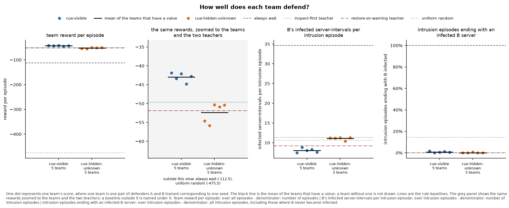
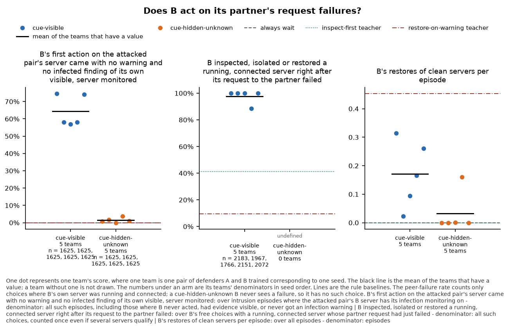
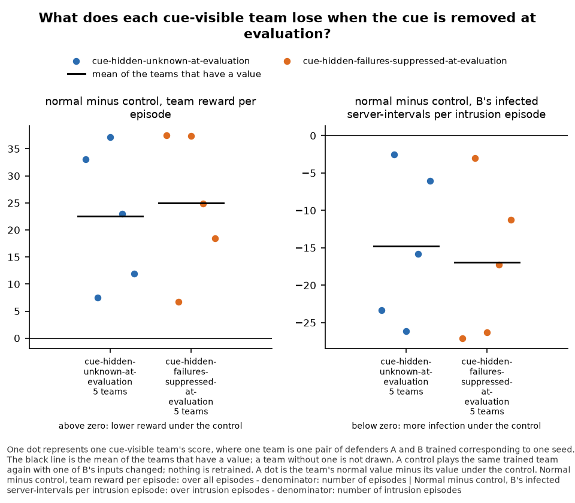
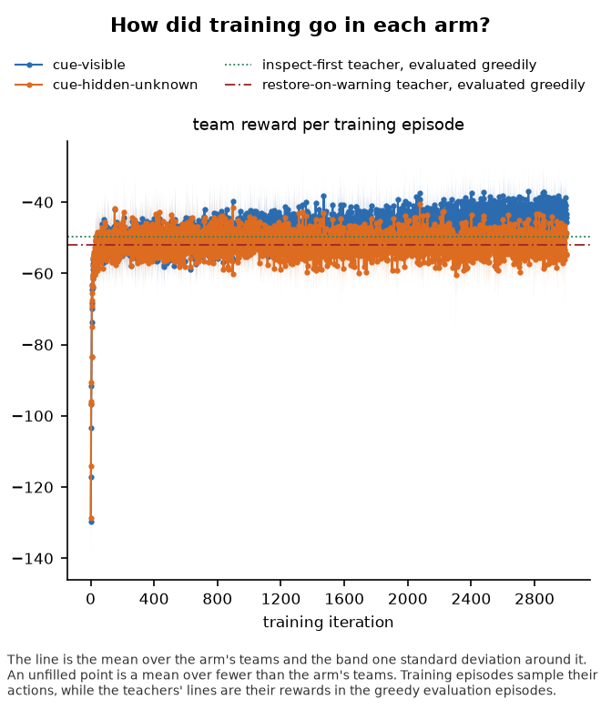

# one false warning

One world of Study 1, the receiver, does B use A's interruptions?. Every team, baseline and control is scored on the same 2000 episodes; the trained teams and the controls choose greedily and the rule baselines follow their rules. One team is one pair of defenders A and B trained for one seed. A mean is over the teams that have a value, with their number; a value with nothing to count is shown as undefined, never as zero.

## Teams and baselines

|  | team reward per episode | B's infected server-intervals per intrusion episode | intrusion episodes ending with an infected B server | B's first action on the attacked pair's server came with no warning and no infected finding of its own visible, server monitored | B inspected, isolated or restored a running, connected server right after its request to the partner failed |
|---|---|---|---|---|---|
| cue-visible, seed 0 | -41.85 | 7.434 | 1.6% | 74.6% | 100.0% |
| cue-visible, seed 1 | -43.35 | 8.83 | 0.0% | 58.1% | 99.9% |
| cue-visible, seed 2 | -42.12 | 8.049 | 0.62% | 57.0% | 100.0% |
| cue-visible, seed 3 | -44.8 | 8.271 | 1.2% | 58.0% | 88.4% |
| cue-visible, seed 4 | -42.76 | 7.558 | 0.55% | 74.2% | 100.0% |
| **cue-visible, mean** | **-42.97** (5 teams) | **8.028** (5 teams) | **0.79%** (5 teams) | **64.4%** (5 teams) | **97.7%** (5 teams) |
| cue-hidden-unknown, seed 0 | -54.61 | 11.19 | 0.0% | 0.86% | undefined |
| cue-hidden-unknown, seed 1 | -55.81 | 11.15 | 0.0% | 1.8% | undefined |
| cue-hidden-unknown, seed 2 | -50.33 | 11.31 | 0.80% | 0.0% | undefined |
| cue-hidden-unknown, seed 3 | -50.86 | 10.38 | 0.0% | 3.8% | undefined |
| cue-hidden-unknown, seed 4 | -50.37 | 11.31 | 0.0% | 1.0% | undefined |
| **cue-hidden-unknown, mean** | **-52.4** (5 teams) | **11.07** (5 teams) | **0.16%** (5 teams) | **1.5%** (5 teams) | **undefined** (0 teams) |
| always wait | -112.5 | 34.64 | 100.0% | 0.0% | undefined |
| inspect-first teacher | -49.67 | 11.37 | 0.0% | 0.0% | 41.3% |
| restore-on-warning teacher | -51.91 | 9.172 | 0.0% | 0.0% | 9.5% |
| uniform random | -475.5 | 10.65 | 14.3% | 65.2% | 28.8% |

Every measurement of every team, baseline and control, with its numerator and denominator, is in [world_table.csv](world_table.csv). Each arm's five teams with their mean, standard deviation, minimum and maximum are in `training-arms/<arm>/arm_summary.csv`. The study's measurements.csv defines every measurement.

## Figures

### How well does each team defend?

The points drawn are in [figures/W1-performance.csv](figures/W1-performance.csv), the vector version in [figures/W1-performance.svg](figures/W1-performance.svg).

### Does B act on its partner's request failures?

The points drawn are in [figures/W2-behaviour.csv](figures/W2-behaviour.csv), the vector version in [figures/W2-behaviour.svg](figures/W2-behaviour.svg).

### What does each cue-visible team lose when the cue is removed at evaluation?

The points drawn are in [figures/W3-controls.csv](figures/W3-controls.csv), the vector version in [figures/W3-controls.svg](figures/W3-controls.svg).

### How did training go in each arm?

The points drawn are in [figures/W4-learning.csv](figures/W4-learning.csv), the vector version in [figures/W4-learning.svg](figures/W4-learning.svg).

## Example episodes

No episode has been chosen yet.
