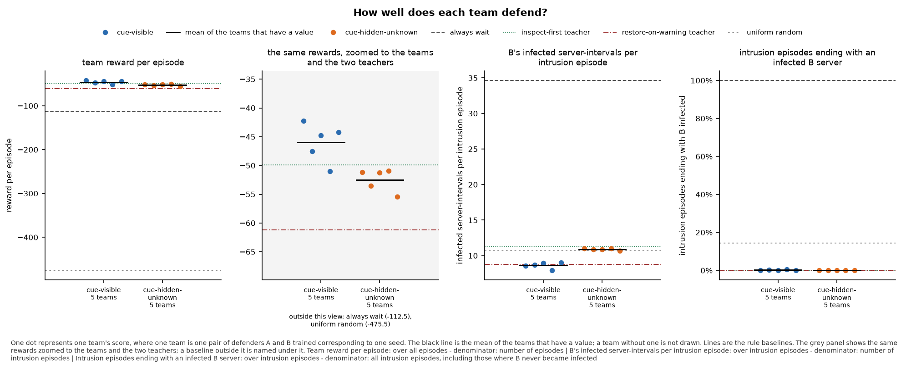
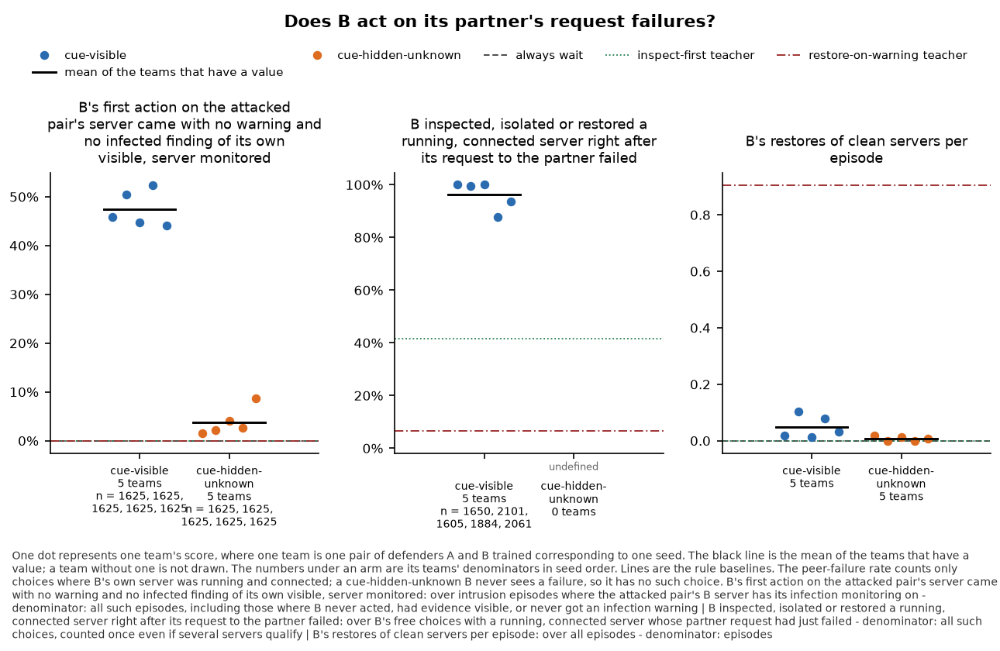
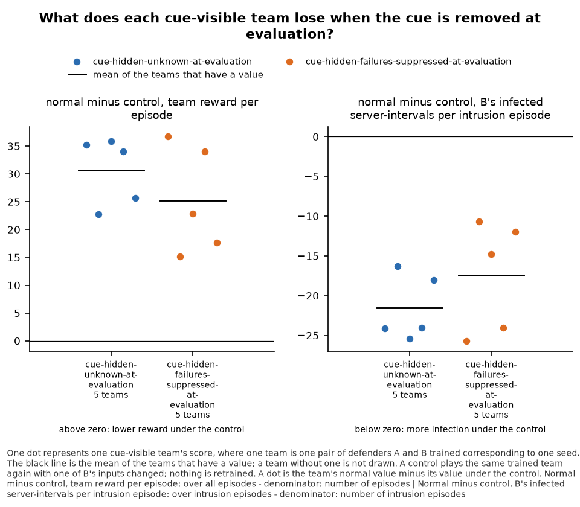
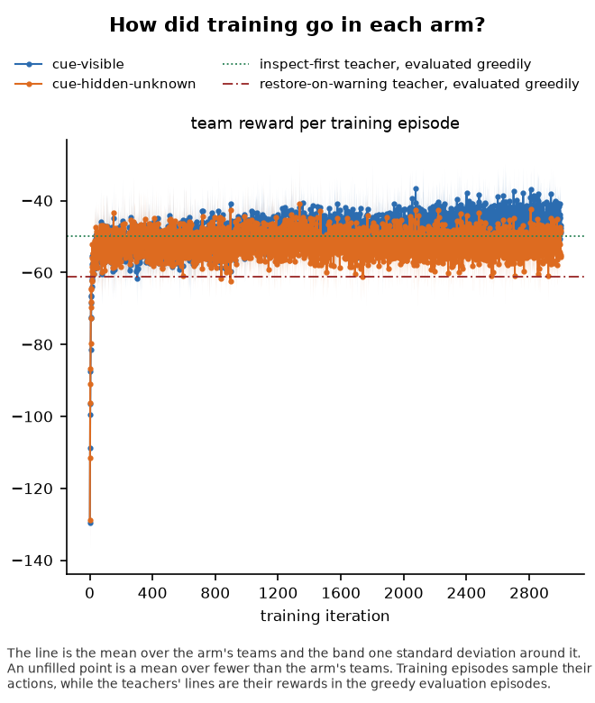

# two false warnings

One world of Study 1, the receiver, does B use A's interruptions?. Every team, baseline and control is scored on the same 2000 episodes; the trained teams and the controls choose greedily and the rule baselines follow their rules. One team is one pair of defenders A and B trained for one seed. A mean is over the teams that have a value, with their number; a value with nothing to count is shown as undefined, never as zero.

## Teams and baselines

|  | team reward per episode | B's infected server-intervals per intrusion episode | intrusion episodes ending with an infected B server | B's first action on the attacked pair's server came with no warning and no infected finding of its own visible, server monitored | B inspected, isolated or restored a running, connected server right after its request to the partner failed |
|---|---|---|---|---|---|
| cue-visible, seed 0 | -42.24 | 8.566 | 0.12% | 45.8% | 100.0% |
| cue-visible, seed 1 | -47.52 | 8.692 | 0.31% | 50.5% | 99.6% |
| cue-visible, seed 2 | -44.75 | 8.95 | 0.0% | 44.7% | 100.0% |
| cue-visible, seed 3 | -51.03 | 7.922 | 0.43% | 52.4% | 87.6% |
| cue-visible, seed 4 | -44.19 | 9.039 | 0.0% | 44.1% | 93.6% |
| **cue-visible, mean** | **-45.95** (5 teams) | **8.634** (5 teams) | **0.17%** (5 teams) | **47.5%** (5 teams) | **96.2%** (5 teams) |
| cue-hidden-unknown, seed 0 | -51.18 | 10.99 | 0.0% | 1.5% | undefined |
| cue-hidden-unknown, seed 1 | -53.56 | 10.89 | 0.0% | 2.1% | undefined |
| cue-hidden-unknown, seed 2 | -51.24 | 10.88 | 0.12% | 4.1% | undefined |
| cue-hidden-unknown, seed 3 | -50.93 | 10.98 | 0.0% | 2.6% | undefined |
| cue-hidden-unknown, seed 4 | -55.46 | 10.65 | 0.0% | 8.7% | undefined |
| **cue-hidden-unknown, mean** | **-52.47** (5 teams) | **10.88** (5 teams) | **0.02%** (5 teams) | **3.8%** (5 teams) | **undefined** (0 teams) |
| always wait | -112.5 | 34.64 | 100.0% | 0.0% | undefined |
| inspect-first teacher | -49.9 | 11.28 | 0.0% | 0.0% | 41.5% |
| restore-on-warning teacher | -61.22 | 8.785 | 0.0% | 0.0% | 6.6% |
| uniform random | -475.5 | 10.65 | 14.3% | 62.3% | 28.8% |

Every measurement of every team, baseline and control, with its numerator and denominator, is in [world_table.csv](world_table.csv). Each arm's five teams with their mean, standard deviation, minimum and maximum are in `training-arms/<arm>/arm_summary.csv`. The study's measurements.csv defines every measurement.

## Figures

### How well does each team defend?

The points drawn are in [figures/W1-performance.csv](figures/W1-performance.csv), the vector version in [figures/W1-performance.svg](figures/W1-performance.svg).

### Does B act on its partner's request failures?

The points drawn are in [figures/W2-behaviour.csv](figures/W2-behaviour.csv), the vector version in [figures/W2-behaviour.svg](figures/W2-behaviour.svg).

### What does each cue-visible team lose when the cue is removed at evaluation?

The points drawn are in [figures/W3-controls.csv](figures/W3-controls.csv), the vector version in [figures/W3-controls.svg](figures/W3-controls.svg).

### How did training go in each arm?

The points drawn are in [figures/W4-learning.csv](figures/W4-learning.csv), the vector version in [figures/W4-learning.svg](figures/W4-learning.svg).

## Example episodes

No episode has been chosen yet.
