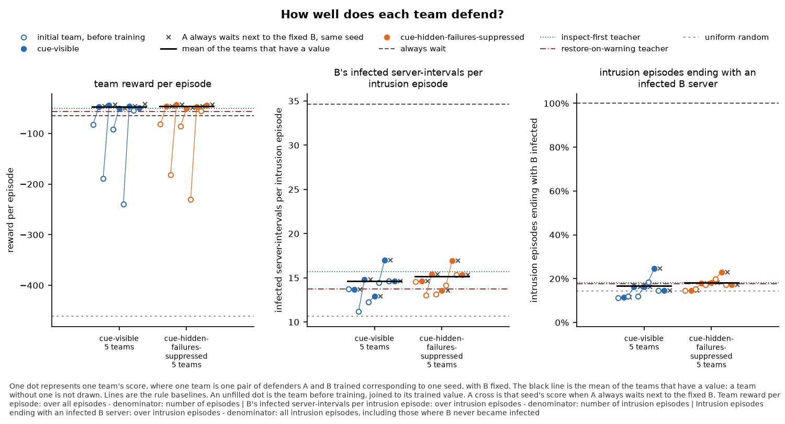
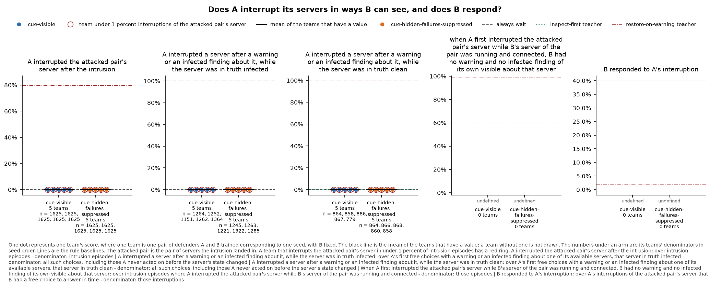
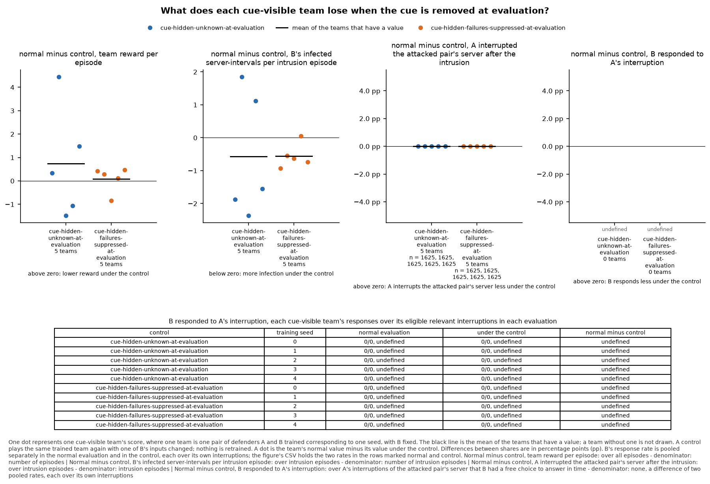
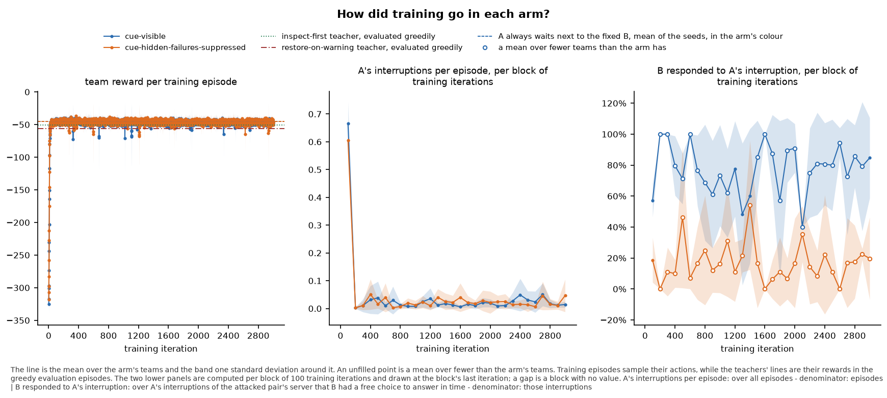
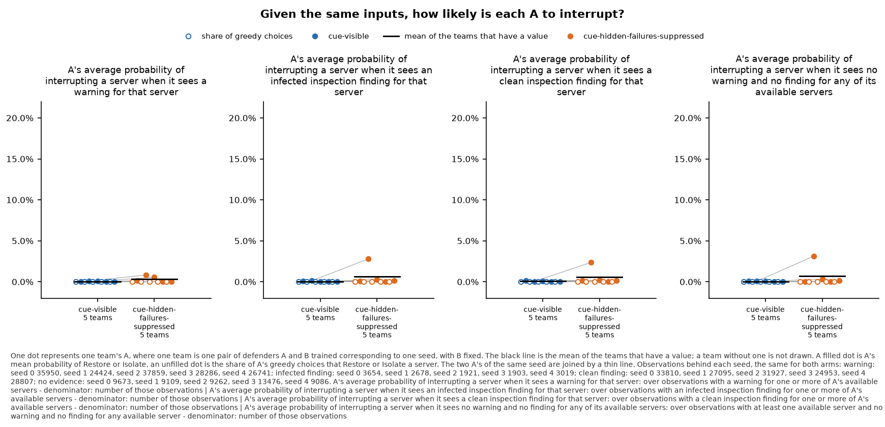

# one false warning missed warnings outages

One world of Study 3, A from random weights next to a fixed B. Every team, baseline and control is scored on the same 2000 episodes; the trained teams and the controls choose greedily and the rule baselines follow their rules. One team is one pair of defenders A and B trained for one seed. A mean is over the teams that have a value, with their number; a value with nothing to count is shown as undefined, never as zero.

## Teams and baselines

|  | team reward per episode | B's infected server-intervals per intrusion episode | intrusion episodes ending with an infected B server | A interrupted the attacked pair's server after the intrusion | B responded to A's interruption |
|---|---|---|---|---|---|
| cue-visible, seed 0, under 1 percent interruptions of the attacked pair's server | -46.82 | 13.7 | 11.6% | 0.0% | undefined |
| cue-visible, seed 1, under 1 percent interruptions of the attacked pair's server | -43.95 | 14.82 | 16.4% | 0.0% | undefined |
| cue-visible, seed 2, under 1 percent interruptions of the attacked pair's server | -50.37 | 12.92 | 16.4% | 0.0% | undefined |
| cue-visible, seed 3, under 1 percent interruptions of the attacked pair's server | -45.86 | 16.97 | 24.6% | 0.0% | undefined |
| cue-visible, seed 4, under 1 percent interruptions of the attacked pair's server | -49.08 | 14.61 | 14.6% | 0.0% | undefined |
| **cue-visible, mean** | **-47.21** (5 teams) | **14.61** (5 teams) | **16.7%** (5 teams) | **0.0%** (5 teams) | **undefined** (0 teams) |
| cue-hidden-failures-suppressed, seed 0, under 1 percent interruptions of the attacked pair's server | -46.71 | 14.63 | 14.6% | 0.0% | undefined |
| cue-hidden-failures-suppressed, seed 1, under 1 percent interruptions of the attacked pair's server | -43.23 | 15.37 | 17.8% | 0.0% | undefined |
| cue-hidden-failures-suppressed, seed 2, under 1 percent interruptions of the attacked pair's server | -50.77 | 13.56 | 18.2% | 0.0% | undefined |
| cue-hidden-failures-suppressed, seed 3, under 1 percent interruptions of the attacked pair's server | -46.9 | 16.91 | 23.0% | 0.0% | undefined |
| cue-hidden-failures-suppressed, seed 4, under 1 percent interruptions of the attacked pair's server | -44.34 | 15.35 | 17.1% | 0.0% | undefined |
| **cue-hidden-failures-suppressed, mean** | **-46.39** (5 teams) | **15.17** (5 teams) | **18.2%** (5 teams) | **0.0%** (5 teams) | **undefined** (0 teams) |
| always wait | -65.28 | 34.63 | 100.0% | 0.0% | undefined |
| inspect-first teacher | -50.31 | 15.7 | 18.3% | 83.0% | 39.9% |
| restore-on-warning teacher | -56.22 | 13.73 | 17.7% | 79.6% | 1.8% |
| uniform random | -461 | 10.65 | 14.3% | 71.2% | 19.8% |
| A always waits next to the fixed B, cue-visible, seed 0 | -45.81 | 13.7 | 11.6% | 0.0% | undefined |
| A always waits next to the fixed B, cue-hidden-failures-suppressed, seed 0 | -46.23 | 14.63 | 14.6% | 0.0% | undefined |
| A always waits next to the fixed B, cue-visible, seed 1 | -42.95 | 14.82 | 16.4% | 0.0% | undefined |
| A always waits next to the fixed B, cue-hidden-failures-suppressed, seed 1 | -43.22 | 15.37 | 17.8% | 0.0% | undefined |
| A always waits next to the fixed B, cue-visible, seed 2 | -50.37 | 12.92 | 16.4% | 0.0% | undefined |
| A always waits next to the fixed B, cue-hidden-failures-suppressed, seed 2 | -49.52 | 13.56 | 18.2% | 0.0% | undefined |
| A always waits next to the fixed B, cue-visible, seed 3 | -45.86 | 16.97 | 24.6% | 0.0% | undefined |
| A always waits next to the fixed B, cue-hidden-failures-suppressed, seed 3 | -45.97 | 16.91 | 23.0% | 0.0% | undefined |
| A always waits next to the fixed B, cue-visible, seed 4 | -42.28 | 14.61 | 14.6% | 0.0% | undefined |
| A always waits next to the fixed B, cue-hidden-failures-suppressed, seed 4 | -42.75 | 15.35 | 17.1% | 0.0% | undefined |

Every measurement of every team, baseline and control, with its numerator and denominator, is in [world_table.csv](world_table.csv). Each arm's five teams with their mean, standard deviation, minimum and maximum are in `training-arms/<arm>/arm_summary.csv`. The study's measurements.csv defines every measurement.

## Figures

### How well does each team defend?

The points drawn are in [figures/W1-performance.csv](figures/W1-performance.csv), the vector version in [figures/W1-performance.svg](figures/W1-performance.svg).

### Does A interrupt its servers in ways B can see, and does B respond?

The points drawn are in [figures/W2-signalling.csv](figures/W2-signalling.csv), the vector version in [figures/W2-signalling.svg](figures/W2-signalling.svg).

### What does each cue-visible team lose when the cue is removed at evaluation?

The points drawn are in [figures/W3-controls.csv](figures/W3-controls.csv), the vector version in [figures/W3-controls.svg](figures/W3-controls.svg).

### How did training go in each arm?

The points drawn are in [figures/W4-learning.csv](figures/W4-learning.csv), the vector version in [figures/W4-learning.svg](figures/W4-learning.svg).

### Given the same inputs, how likely is each A to interrupt?

The points drawn are in [figures/W5-probe.csv](figures/W5-probe.csv), the vector version in [figures/W5-probe.svg](figures/W5-probe.svg).

## Example episodes

No episode has been chosen yet.
