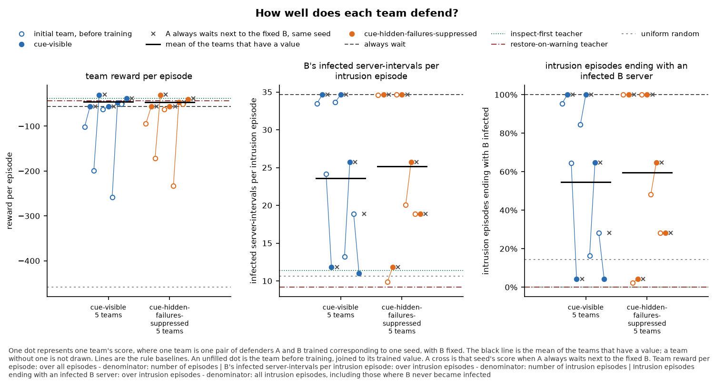
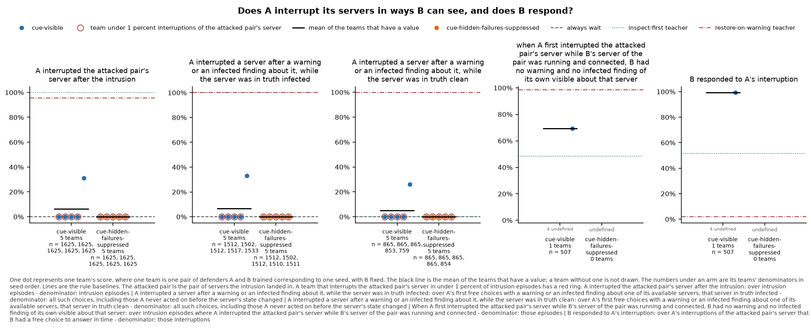
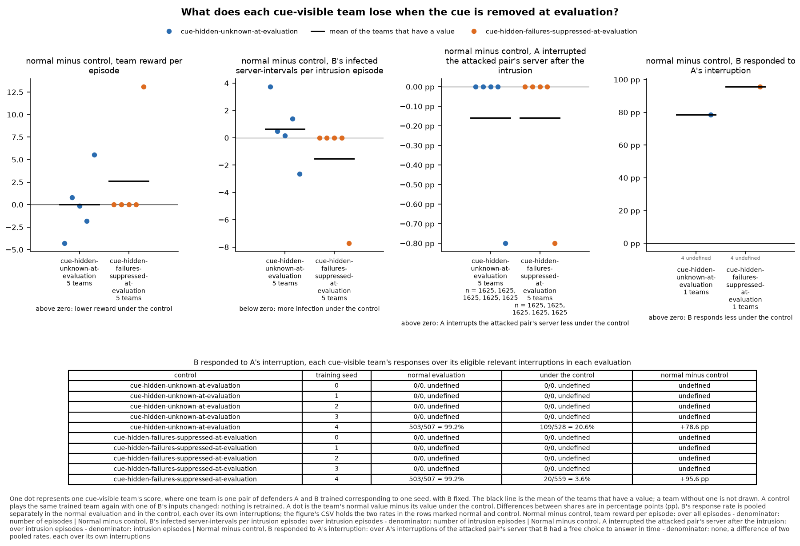
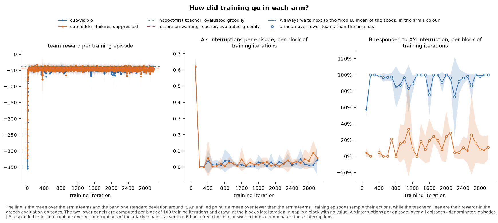
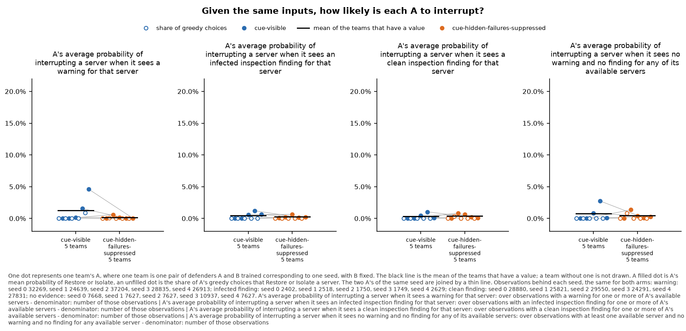

# one false warning

One world of Study 3, A from random weights next to a fixed B. Every team, baseline and control is scored on the same 2000 episodes; the trained teams and the controls choose greedily and the rule baselines follow their rules. One team is one pair of defenders A and B trained for one seed. A mean is over the teams that have a value, with their number; a value with nothing to count is shown as undefined, never as zero.

## Teams and baselines

|  | team reward per episode | B's infected server-intervals per intrusion episode | intrusion episodes ending with an infected B server | A interrupted the attacked pair's server after the intrusion | B responded to A's interruption |
|---|---|---|---|---|---|
| cue-visible, seed 0, under 1 percent interruptions of the attacked pair's server | -56.3 | 34.64 | 100.0% | 0.0% | undefined |
| cue-visible, seed 1, under 1 percent interruptions of the attacked pair's server | -30.18 | 11.83 | 4.2% | 0.0% | undefined |
| cue-visible, seed 2, under 1 percent interruptions of the attacked pair's server | -56.3 | 34.64 | 100.0% | 0.0% | undefined |
| cue-visible, seed 3, under 1 percent interruptions of the attacked pair's server | -47.91 | 25.73 | 64.7% | 0.0% | undefined |
| cue-visible, seed 4 | -38.21 | 11 | 4.2% | 31.2% | 99.2% |
| **cue-visible, mean** | **-45.78** (5 teams) | **23.57** (5 teams) | **54.6%** (5 teams) | **6.2%** (5 teams) | **99.2%** (1 teams) |
| cue-hidden-failures-suppressed, seed 0, under 1 percent interruptions of the attacked pair's server | -56.3 | 34.64 | 100.0% | 0.0% | undefined |
| cue-hidden-failures-suppressed, seed 1, under 1 percent interruptions of the attacked pair's server | -30.84 | 11.83 | 4.2% | 0.0% | undefined |
| cue-hidden-failures-suppressed, seed 2, under 1 percent interruptions of the attacked pair's server | -56.3 | 34.64 | 100.0% | 0.0% | undefined |
| cue-hidden-failures-suppressed, seed 3, under 1 percent interruptions of the attacked pair's server | -46.26 | 25.73 | 64.7% | 0.0% | undefined |
| cue-hidden-failures-suppressed, seed 4, under 1 percent interruptions of the attacked pair's server | -40.22 | 18.86 | 28.3% | 0.0% | undefined |
| **cue-hidden-failures-suppressed, mean** | **-45.98** (5 teams) | **25.14** (5 teams) | **59.5%** (5 teams) | **0.0%** (5 teams) | **undefined** (0 teams) |
| always wait | -56.3 | 34.64 | 100.0% | 0.0% | undefined |
| inspect-first teacher | -37.5 | 11.37 | 0.0% | 99.8% | 51.7% |
| restore-on-warning teacher | -43.2 | 9.172 | 0.0% | 95.6% | 1.9% |
| uniform random | -458.9 | 10.65 | 14.3% | 71.4% | 19.8% |
| A always waits next to the fixed B, seed 0 | -56.3 | 34.64 | 100.0% | 0.0% | undefined |
| A always waits next to the fixed B, seed 1 | -29.72 | 11.83 | 4.2% | 0.0% | undefined |
| A always waits next to the fixed B, seed 2 | -56.3 | 34.64 | 100.0% | 0.0% | undefined |
| A always waits next to the fixed B, seed 3 | -46.26 | 25.73 | 64.7% | 0.0% | undefined |
| A always waits next to the fixed B, seed 4 | -38.55 | 18.86 | 28.3% | 0.0% | undefined |

Every measurement of every team, baseline and control, with its numerator and denominator, is in [world_table.csv](world_table.csv). Each arm's five teams with their mean, standard deviation, minimum and maximum are in `training-arms/<arm>/arm_summary.csv`. The study's measurements.csv defines every measurement.

## Figures

### How well does each team defend?

The points drawn are in [figures/W1-performance.csv](figures/W1-performance.csv), the vector version in [figures/W1-performance.svg](figures/W1-performance.svg).

### Does A interrupt its servers in ways B can see, and does B respond?

The points drawn are in [figures/W2-signalling.csv](figures/W2-signalling.csv), the vector version in [figures/W2-signalling.svg](figures/W2-signalling.svg).

### What does each cue-visible team lose when the cue is removed at evaluation?

The points drawn are in [figures/W3-controls.csv](figures/W3-controls.csv), the vector version in [figures/W3-controls.svg](figures/W3-controls.svg).

### How did training go in each arm?

The points drawn are in [figures/W4-learning.csv](figures/W4-learning.csv), the vector version in [figures/W4-learning.svg](figures/W4-learning.svg).

### Given the same inputs, how likely is each A to interrupt?

The points drawn are in [figures/W5-probe.csv](figures/W5-probe.csv), the vector version in [figures/W5-probe.svg](figures/W5-probe.svg).

## Example episodes

No episode has been chosen yet.
