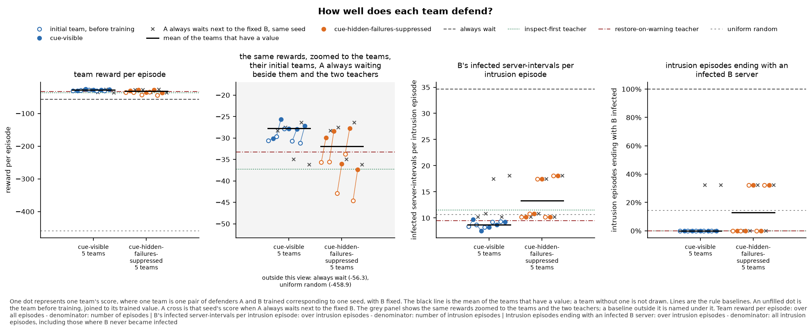
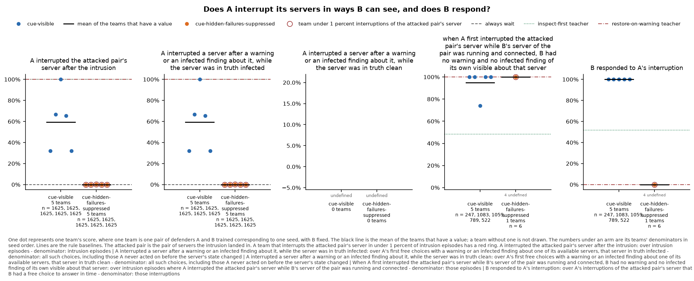
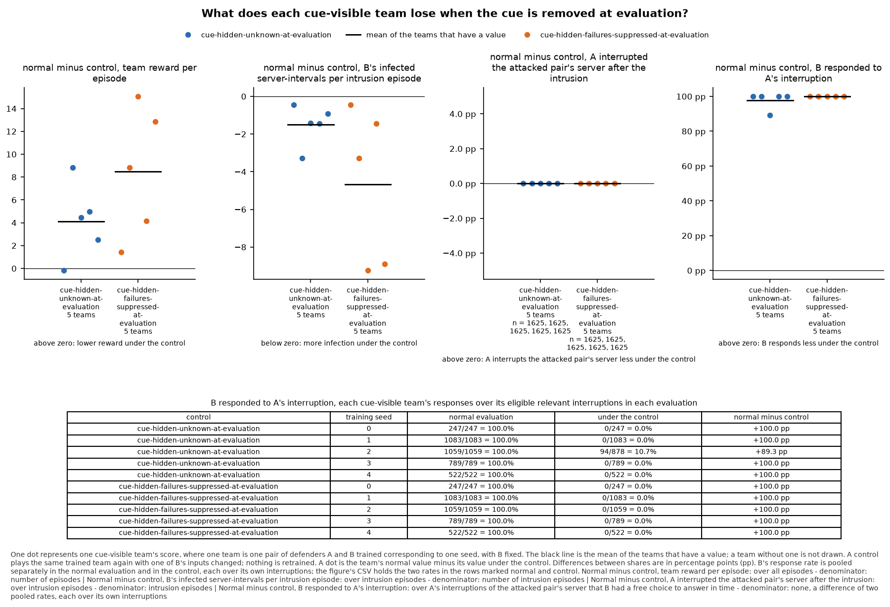
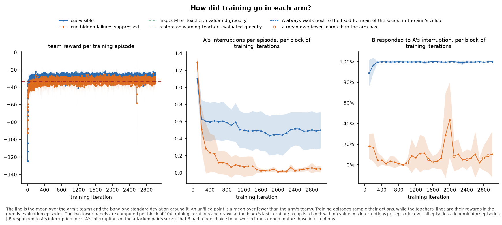
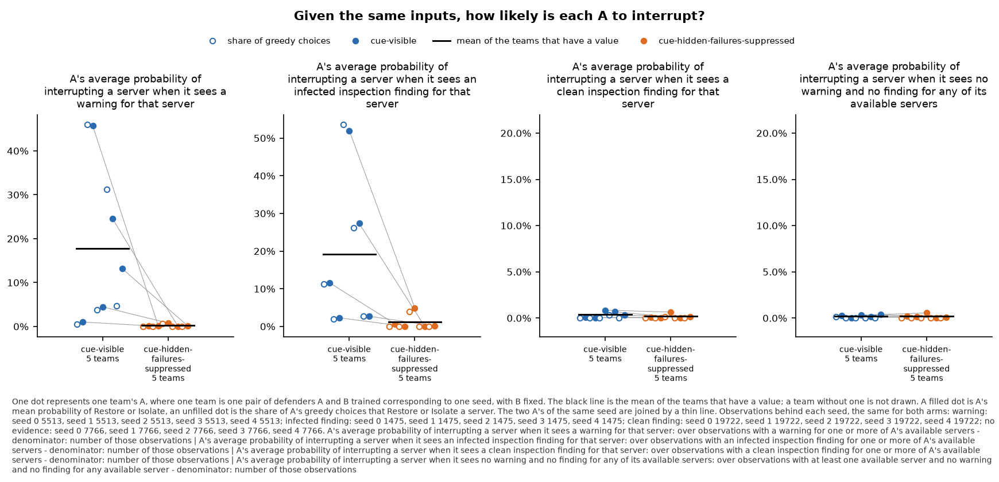

# reliable warnings

One world of Study 4, A from the teacher next to a fixed B. Every team, baseline and control is scored on the same 2000 episodes; the trained teams and the controls choose greedily and the rule baselines follow their rules. One team is one pair of defenders A and B trained for one seed. A mean is over the teams that have a value, with their number; a value with nothing to count is shown as undefined, never as zero.

## Teams and baselines

|  | team reward per episode | B's infected server-intervals per intrusion episode | intrusion episodes ending with an infected B server | A interrupted the attacked pair's server after the intrusion | B responded to A's interruption |
|---|---|---|---|---|---|
| cue-visible, seed 0 | -30.09 | 9.694 | 0.0% | 32.1% | 100.0% |
| cue-visible, seed 1 | -25.62 | 7.546 | 0.0% | 66.6% | 100.0% |
| cue-visible, seed 2 | -27.8 | 8.204 | 0.0% | 100.0% | 100.0% |
| cue-visible, seed 3 | -27.9 | 8.729 | 0.0% | 65.5% | 100.0% |
| cue-visible, seed 4 | -27.21 | 9.228 | 0.0% | 32.1% | 100.0% |
| **cue-visible, mean** | **-27.72** (5 teams) | **8.68** (5 teams) | **0.0%** (5 teams) | **59.3%** (5 teams) | **100.0%** (5 teams) |
| cue-hidden-failures-suppressed, seed 0, under 1 percent interruptions of the attacked pair's server | -29.95 | 10.15 | 0.0% | 0.0% | undefined |
| cue-hidden-failures-suppressed, seed 1, under 1 percent interruptions of the attacked pair's server | -28.39 | 10.82 | 0.0% | 0.0% | undefined |
| cue-hidden-failures-suppressed, seed 2, under 1 percent interruptions of the attacked pair's server | -36.06 | 17.45 | 32.1% | 0.37% | 0.0% |
| cue-hidden-failures-suppressed, seed 3, under 1 percent interruptions of the attacked pair's server | -27.73 | 10.17 | 0.0% | 0.0% | undefined |
| cue-hidden-failures-suppressed, seed 4, under 1 percent interruptions of the attacked pair's server | -37.38 | 18.11 | 32.1% | 0.0% | undefined |
| **cue-hidden-failures-suppressed, mean** | **-31.9** (5 teams) | **13.34** (5 teams) | **12.8%** (5 teams) | **0.07%** (5 teams) | **0.0%** (1 teams) |
| always wait | -56.3 | 34.64 | 100.0% | 0.0% | undefined |
| inspect-first teacher | -37.29 | 11.48 | 0.0% | 100.0% | 51.8% |
| restore-on-warning teacher | -33.23 | 9.482 | 0.0% | 100.0% | 0.0% |
| uniform random | -458.9 | 10.65 | 14.3% | 71.4% | 19.8% |
| A always waits next to the fixed B, seed 0 | -28.29 | 10.15 | 0.0% | 0.0% | undefined |
| A always waits next to the fixed B, seed 1 | -27.6 | 10.82 | 0.0% | 0.0% | undefined |
| A always waits next to the fixed B, seed 2 | -34.97 | 17.45 | 32.1% | 0.0% | undefined |
| A always waits next to the fixed B, seed 3 | -26.42 | 10.17 | 0.0% | 0.0% | undefined |
| A always waits next to the fixed B, seed 4 | -36.19 | 18.11 | 32.1% | 0.0% | undefined |

Every measurement of every team, baseline and control, with its numerator and denominator, is in [world_table.csv](world_table.csv). Each arm's five teams with their mean, standard deviation, minimum and maximum are in `training-arms/<arm>/arm_summary.csv`. The study's measurements.csv defines every measurement.

## Figures

### How well does each team defend?

The points drawn are in [figures/W1-performance.csv](figures/W1-performance.csv), the vector version in [figures/W1-performance.svg](figures/W1-performance.svg).

### Does A interrupt its servers in ways B can see, and does B respond?

The points drawn are in [figures/W2-signalling.csv](figures/W2-signalling.csv), the vector version in [figures/W2-signalling.svg](figures/W2-signalling.svg).

### What does each cue-visible team lose when the cue is removed at evaluation?

The points drawn are in [figures/W3-controls.csv](figures/W3-controls.csv), the vector version in [figures/W3-controls.svg](figures/W3-controls.svg).

### How did training go in each arm?

The points drawn are in [figures/W4-learning.csv](figures/W4-learning.csv), the vector version in [figures/W4-learning.svg](figures/W4-learning.svg).

### Given the same inputs, how likely is each A to interrupt?

The points drawn are in [figures/W5-probe.csv](figures/W5-probe.csv), the vector version in [figures/W5-probe.svg](figures/W5-probe.svg).

## Example episodes

No episode has been chosen yet.
