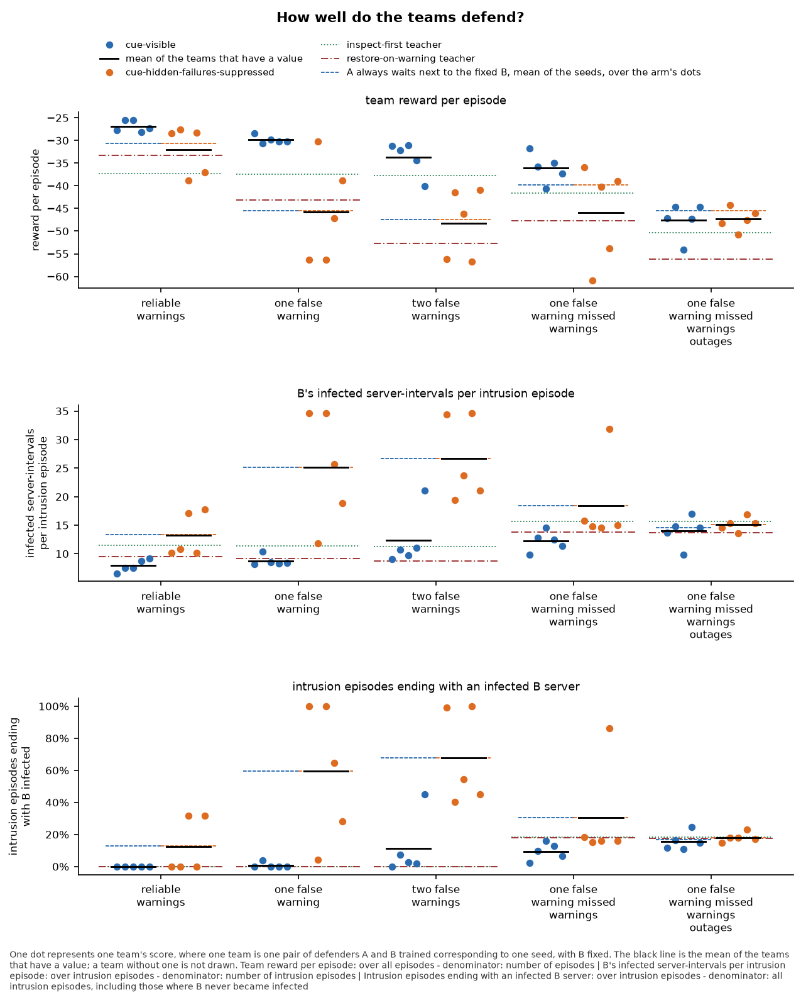
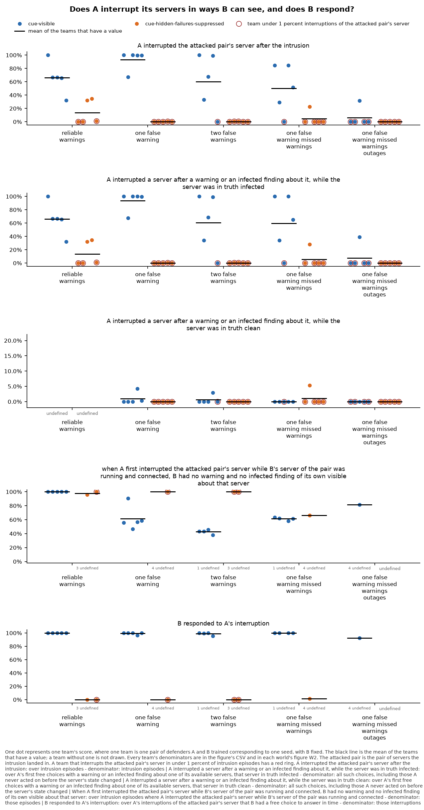
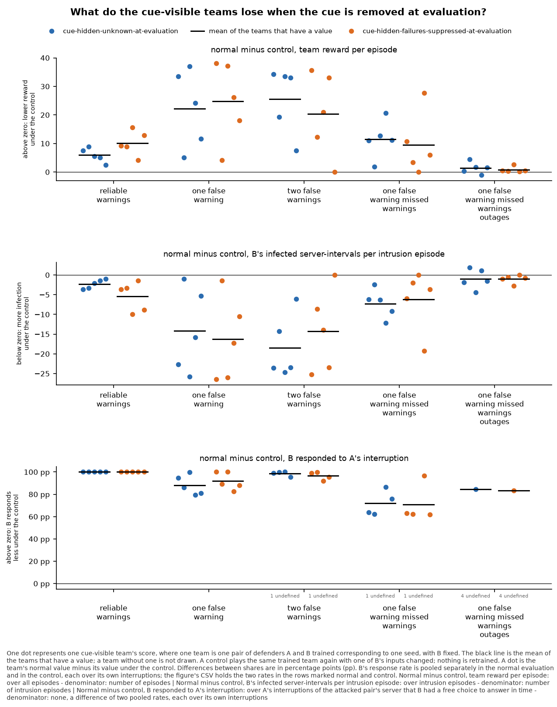
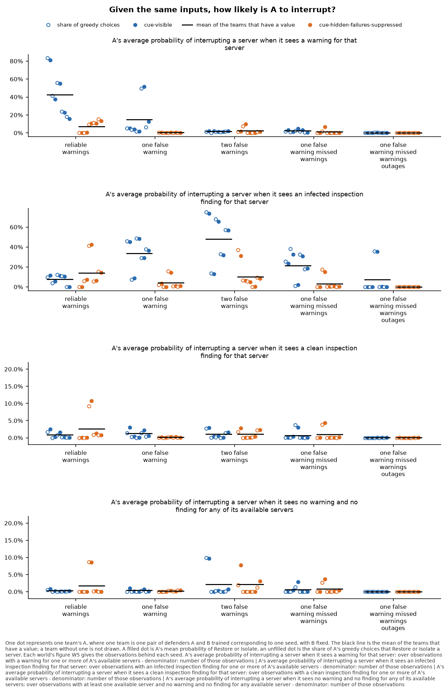

# Study 5, A inherited from study 1 next to a fixed B

The study's five worlds side by side. A value is the mean over the arm's teams that have a value, with their number in brackets. Each world's README lists its teams one by one.

## The worlds

| world | arm | team reward per episode | B's infected server-intervals per intrusion episode | intrusion episodes ending with an infected B server | A interrupted the attacked pair's server after the intrusion | B responded to A's interruption |
|---|---|---|---|---|---|---|
| [reliable warnings](worlds/reliable-warnings/README.md) | cue-visible | -26.85 (5 teams) | 7.923 (5 teams) | 0.0% (5 teams) | 66.2% (5 teams) | 100.0% (5 teams) |
| [reliable warnings](worlds/reliable-warnings/README.md) | cue-hidden-failures-suppressed | -32.04 (5 teams) | 13.22 (5 teams) | 12.6% (5 teams) | 13.5% (5 teams) | 0.0% (2 teams) |
| [one false warning](worlds/one-false-warning/README.md) | cue-visible | -29.84 (5 teams) | 8.724 (5 teams) | 0.78% (5 teams) | 93.3% (5 teams) | 99.3% (5 teams) |
| [one false warning](worlds/one-false-warning/README.md) | cue-hidden-failures-suppressed | -45.77 (5 teams) | 25.14 (5 teams) | 59.5% (5 teams) | 0.14% (5 teams) | 0.0% (1 teams) |
| [two false warnings](worlds/two-false-warnings/README.md) | cue-visible | -33.76 (5 teams) | 12.32 (5 teams) | 11.4% (5 teams) | 60.0% (5 teams) | 98.8% (4 teams) |
| [two false warnings](worlds/two-false-warnings/README.md) | cue-hidden-failures-suppressed | -48.29 (5 teams) | 26.65 (5 teams) | 67.8% (5 teams) | 0.21% (5 teams) | 0.0% (2 teams) |
| [one false warning missed warnings](worlds/one-false-warning-missed-warnings/README.md) | cue-visible | -36.07 (5 teams) | 12.21 (5 teams) | 9.5% (5 teams) | 50.1% (5 teams) | 99.9% (4 teams) |
| [one false warning missed warnings](worlds/one-false-warning-missed-warnings/README.md) | cue-hidden-failures-suppressed | -45.96 (5 teams) | 18.42 (5 teams) | 30.4% (5 teams) | 4.5% (5 teams) | 1.6% (1 teams) |
| [one false warning missed warnings outages](worlds/one-false-warning-missed-warnings-outages/README.md) | cue-visible | -47.56 (5 teams) | 13.98 (5 teams) | 15.6% (5 teams) | 6.4% (5 teams) | 92.3% (1 teams) |
| [one false warning missed warnings outages](worlds/one-false-warning-missed-warnings-outages/README.md) | cue-hidden-failures-suppressed | -47.34 (5 teams) | 15.17 (5 teams) | 18.2% (5 teams) | 0.0% (5 teams) | undefined (0 teams) |

Every mean of the study with its standard deviation and number of teams, the baselines and the control differences are in [master_table.csv](master_table.csv). [measurements.csv](measurements.csv) gives every measurement's id, name, population and denominator.

## Figures

### How well do the teams defend?

The points drawn are in [figures/S1-performance.csv](figures/S1-performance.csv), the vector version in [figures/S1-performance.svg](figures/S1-performance.svg).

### Does A interrupt its servers in ways B can see, and does B respond?

The points drawn are in [figures/S2-signalling.csv](figures/S2-signalling.csv), the vector version in [figures/S2-signalling.svg](figures/S2-signalling.svg).

### What do the cue-visible teams lose when the cue is removed at evaluation?

The points drawn are in [figures/S3-controls.csv](figures/S3-controls.csv), the vector version in [figures/S3-controls.svg](figures/S3-controls.svg).

### Given the same inputs, how likely is A to interrupt?

The points drawn are in [figures/S4-probe.csv](figures/S4-probe.csv), the vector version in [figures/S4-probe.svg](figures/S4-probe.svg).

## Worlds

- [reliable warnings](worlds/reliable-warnings/README.md)
- [one false warning](worlds/one-false-warning/README.md)
- [two false warnings](worlds/two-false-warnings/README.md)
- [one false warning missed warnings](worlds/one-false-warning-missed-warnings/README.md)
- [one false warning missed warnings outages](worlds/one-false-warning-missed-warnings-outages/README.md)
